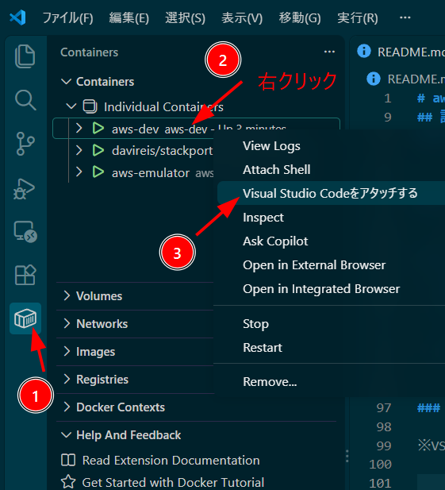
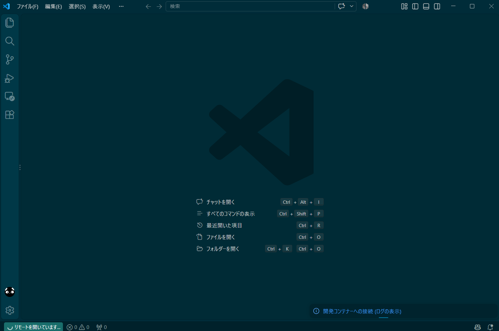
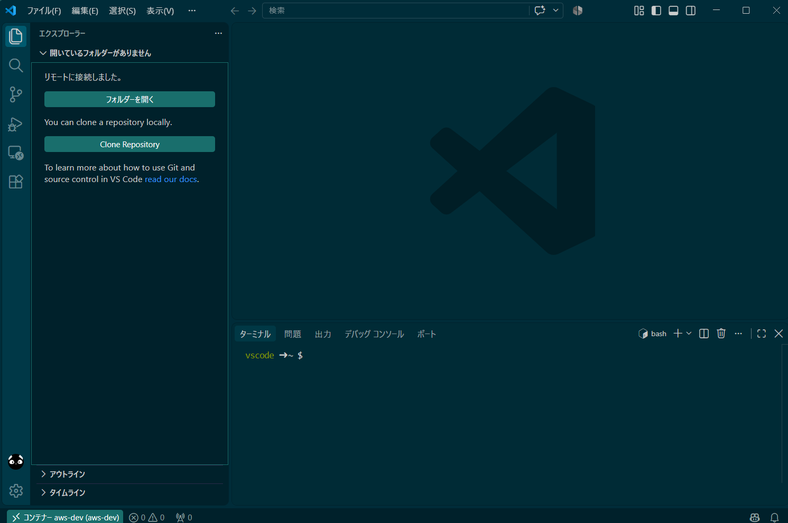
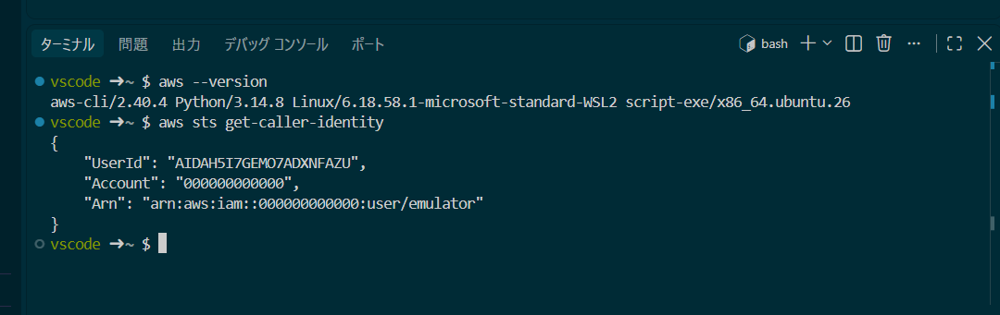
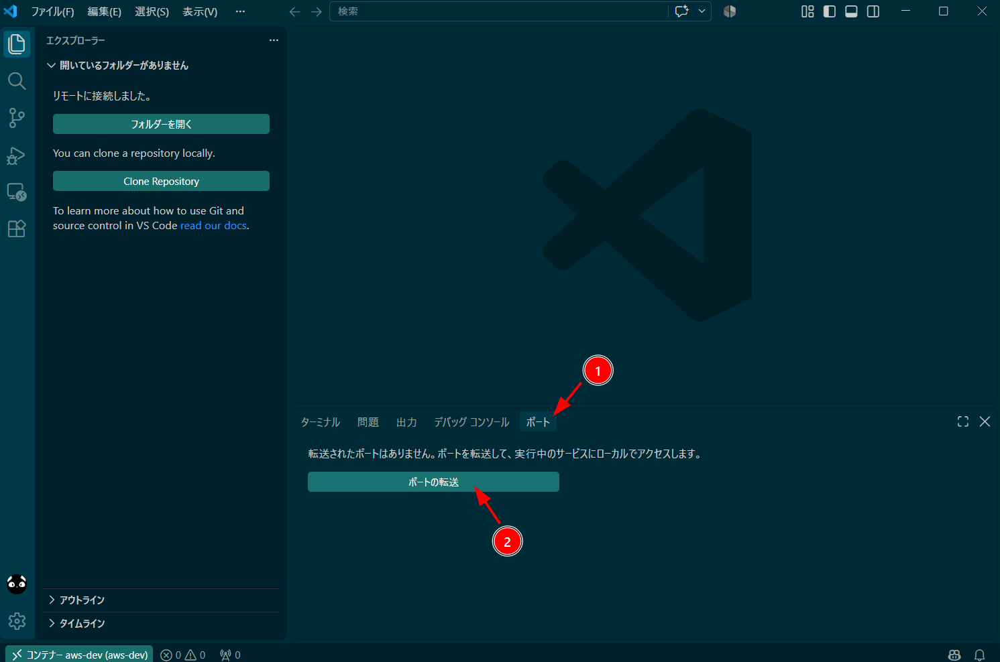
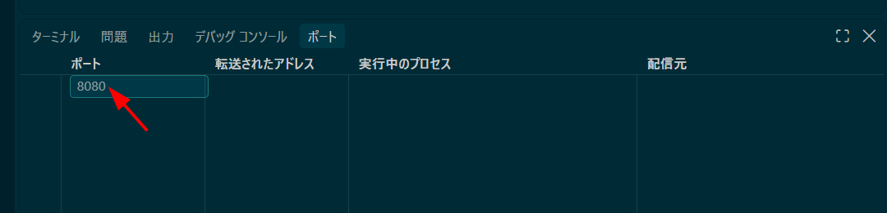
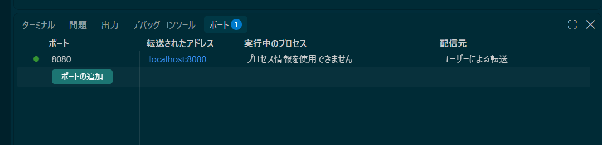
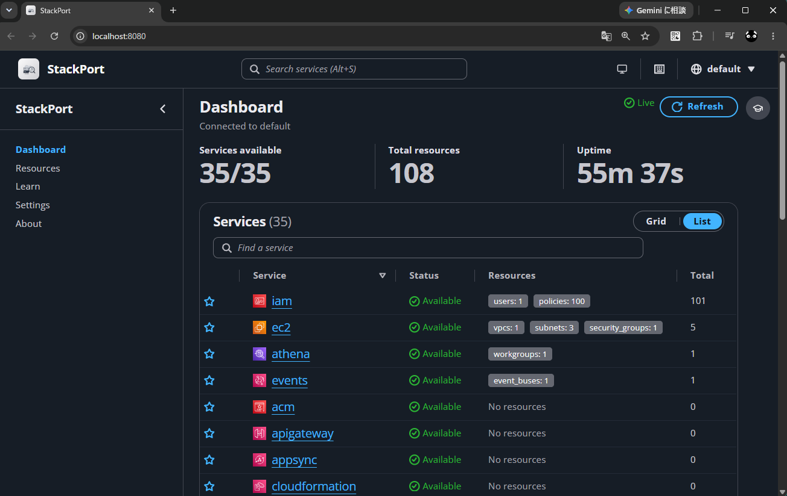

# aws_emulator_study2

## 概要

* 前回: [公式の AWS ローカルエミュレーターが出たので試してみる](https://github.com/Tobotobo/aws_emulator_study1)
* 前回をブラッシュアップして、開発用のコンテナの作成と VSCode からアタッチして開発できるようにする

## 詳細

### 環境

* Windows 11
* WSL コンテナ―  
  ```
  > wslc --version
  wslc 3.0.5.0
  ```

### aws-emulator イメージをビルド

Getting started with Docker  
https://docs.aws.amazon.com/emulator/latest/userguide/getting-started-docker.html  

docker/aws-emulator/Dockerfile
```Dockerfile
FROM public.ecr.aws/amazonlinux/amazonlinux:2023-minimal
ADD https://downloads.aws.com/aws-emulator/packages/aws-emulator/LTS/latest/aws-emulator-x86_64.rpm /tmp/aws-emulator.rpm
RUN rpm -i /tmp/aws-emulator.rpm && rm /tmp/aws-emulator.rpm \
    && mkdir -p /home/emulator && chown 1000 /home/emulator
USER 1000
ENV HOME=/home/emulator
EXPOSE 9297
ENTRYPOINT ["aws-emulator", "-b", "0.0.0.0"]
```

```sh
wslc build -t aws-emulator ./docker/aws-emulator
```

バージョン確認
```sh
wslc run --rm aws-emulator -v
```

```
Version: 1.0.471
Release date: 2026.11.16
Commit: 91eb64ca5a78a7d78f4748085e65681abc417e15
```

### aws-emulator コンテナを起動

```sh
wslc run -d `
  --name aws-emulator `
  -v ".\emulator:/home/emulator/.aws/emulator" `
  aws-emulator -p 9297 --telemetry off
```

### .env ファイルを作成

```sh
cp .env.template .env
```

### stackport コンテナを起動

https://hub.docker.com/r/davireis/stackport/tags

```sh
wslc run -d `
  --name stackport `
  --network container:aws-emulator `
  -v "./emulator:/emulator:ro" `
  --env-file .env `
  davireis/stackport:0.4.6
```

### aws-dev コンテナをビルド

```sh
wslc build -t aws-dev ./docker/aws-dev
```

### aws-dev コンテナを起動

```sh
wslc run -d `
  --name aws-dev `
  --network container:aws-emulator `
  -v "./emulator:/emulator:ro" `
  -v "./workspace:/workspace" `
  -w /workspace `
  --env-file .env `
  aws-dev sleep infinity
```

### aws-dev コンテナに VSCode でアタッチ

※VSCode の拡張機能で Dev Containers をインストールしておく

* 左側のパネルで `Containers` をクリック
* Individual Containers の `aws-dev` を右クリック
* 右クリックメニューから `Visual Studio Codeをアタッチする` をクリック



* 新しい Visual Studio Code のウィンドウをが開く
* 右下の `開発コンテナーへの接続 (ログの表示)` が終わるのを待つ
  * 進捗を確認したい場合は、上記をクリックしてログを表示する
  * VSCode サーバーのインストールなどの処理が行われる



* 処理が完了すると以下の画面になる



* ターミナルで aws のコマンドが使える

```sh
vscode ➜ ~ $ aws --version
aws-cli/2.40.4 Python/3.14.8 Linux/6.18.58.1-microsoft-standard-WSL2 script-exe/x86_64.ubuntu.26
vscode ➜ ~ $ aws sts get-caller-identity
{
    "UserId": "AIDAH5I7GEMO7ADXNFAZU",
    "Account": "000000000000",
    "Arn": "arn:aws:iam::000000000000:user/emulator"
}
```




### ポート転送して stackport にアクセス

* 先ほどの `aws-dev コンテナに VSCode でアタッチ` で表示された Visual Studio Code のウィンドウで操作
* 右下のパネルの `ポート` タブをクリック
* `ポートの転送` をクリック



* `8080` を入力しエンター





* ブラウザから http://localhost:8080 にアクセス



### 掃除

```sh
wslc rm -f aws-dev
wslc rm -f stackport
wslc rm -f aws-emulator
```