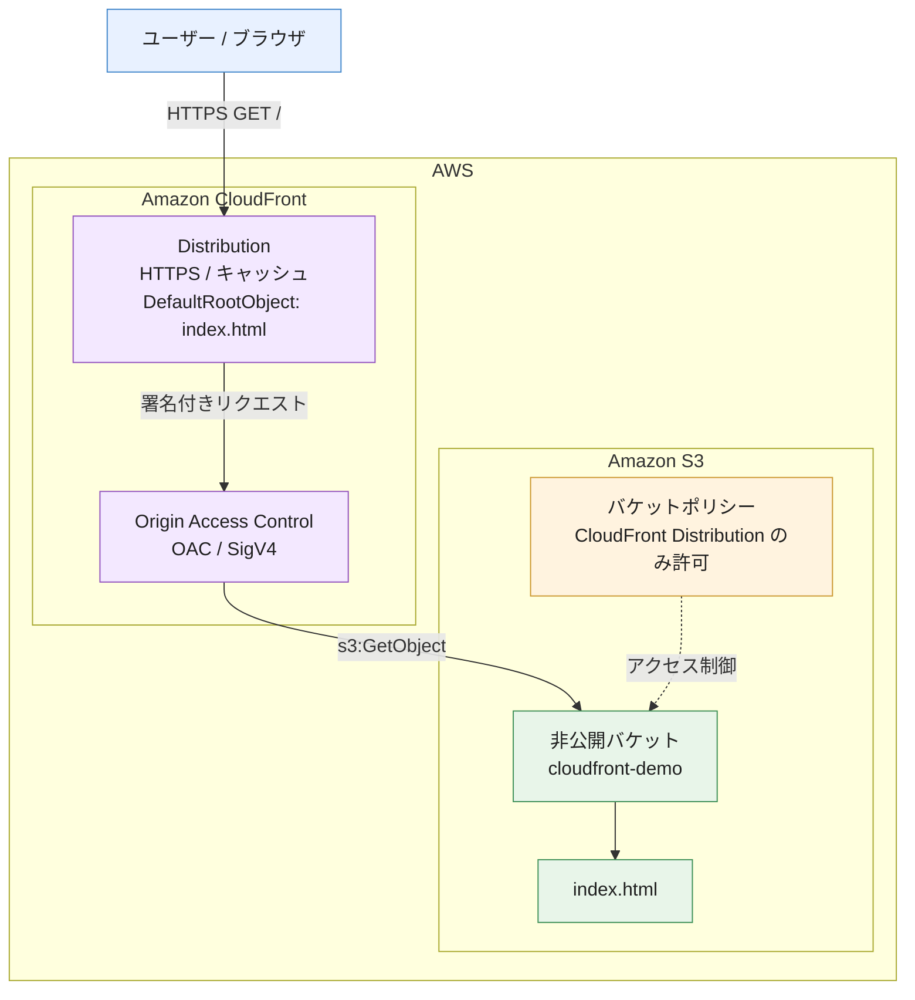
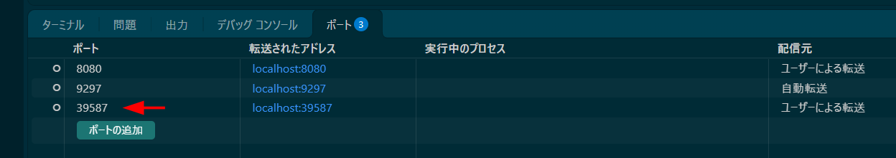
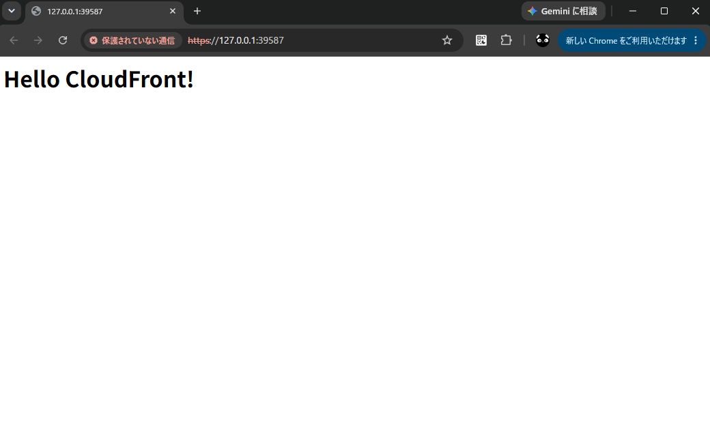
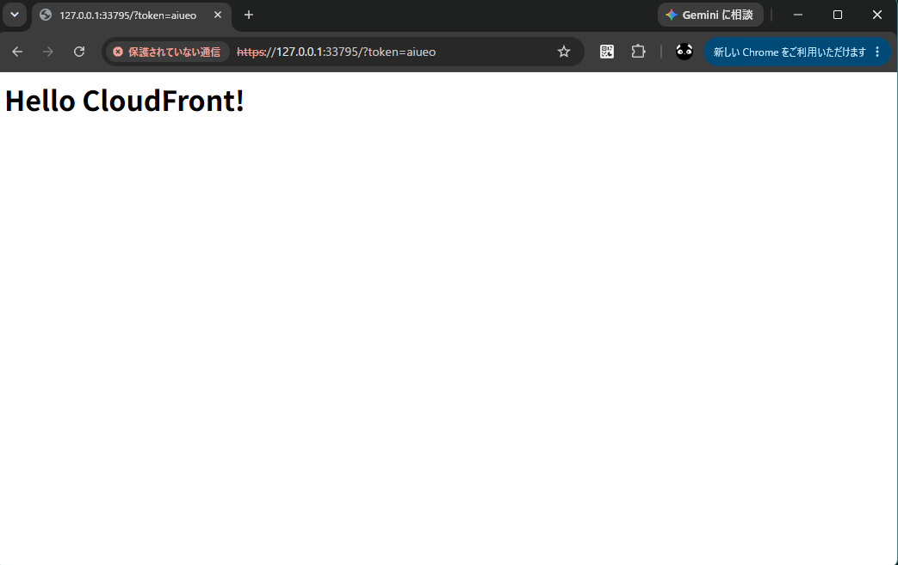
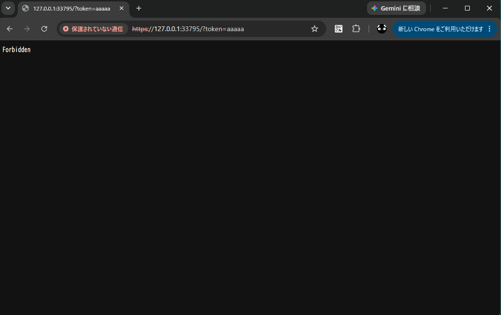
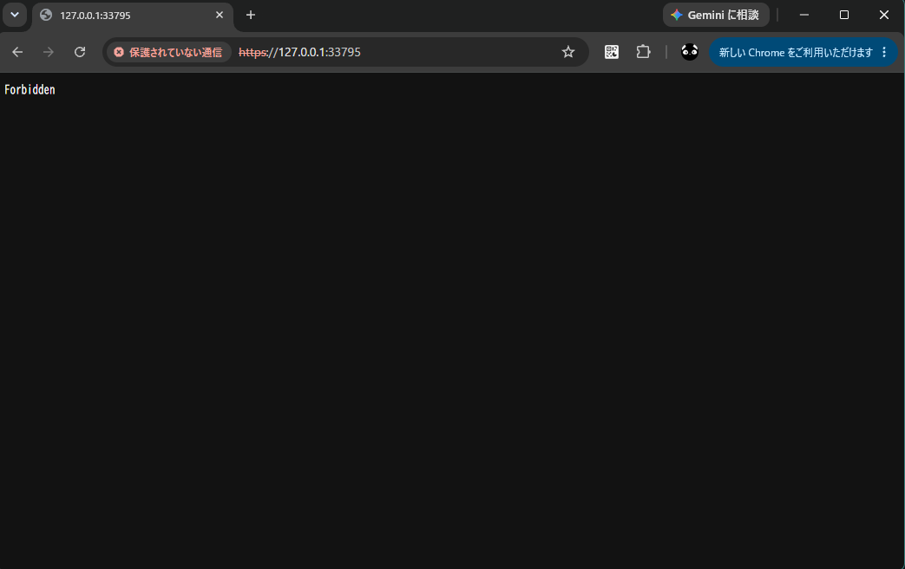

# CloudFront



```sh
# アカウントID 取得
ACCOUNT_ID=$(aws sts get-caller-identity --query Account --output text)

# バケット名
BUCKET=cloudfront-demo

# バケット作成
aws s3 mb s3://$BUCKET

# HTML アップロード
echo '<h1>Hello CloudFront!</h1>' > index.html
aws s3 cp index.html "s3://$BUCKET/index.html" \
  --content-type text/html

# OAC 作成
OAC_ID=$(aws cloudfront create-origin-access-control \
  --origin-access-control-config \
  "Name=$BUCKET-oac,SigningProtocol=sigv4,SigningBehavior=always,OriginAccessControlOriginType=s3" \
  --query OriginAccessControl.Id --output text)
echo $OAC_ID

# CloudFront 作成
cat > distribution.json <<EOF
{
  "CallerReference": "$BUCKET-distribution",
  "Comment": "Simple S3 CloudFront demo",
  "Enabled": true,
  "DefaultRootObject": "index.html",
  "Origins": {
    "Quantity": 1,
    "Items": [{
      "Id": "s3-origin",
      "DomainName": "$BUCKET.s3.us-east-1.amazonaws.com",
      "S3OriginConfig": {
        "OriginAccessIdentity": ""
      },
      "OriginAccessControlId": "$OAC_ID"
    }]
  },
  "DefaultCacheBehavior": {
    "TargetOriginId": "s3-origin",
    "ViewerProtocolPolicy": "redirect-to-https",
    "AllowedMethods": {
      "Quantity": 2,
      "Items": ["GET", "HEAD"],
      "CachedMethods": {
        "Quantity": 2,
        "Items": ["GET", "HEAD"]
      }
    },
    "CachePolicyId": "658327ea-f89d-4fab-a63d-7e88639e58f6",
    "Compress": true
  }
}
EOF

DIST_ID=$(aws cloudfront create-distribution \
  --distribution-config file://distribution.json \
  --query Distribution.Id --output text)
echo $DIST_ID

# S3 バケットポリシー設定
cat > bucket-policy.json <<EOF
{
  "Version": "2012-10-17",
  "Statement": [{
    "Effect": "Allow",
    "Principal": {
      "Service": "cloudfront.amazonaws.com"
    },
    "Action": "s3:GetObject",
    "Resource": "arn:aws:s3:::$BUCKET/*",
    "Condition": {
      "StringEquals": {
        "AWS:SourceArn": "arn:aws:cloudfront::$ACCOUNT_ID:distribution/$DIST_ID"
      }
    }
  }]
}
EOF

aws s3api put-bucket-policy \
  --bucket "$BUCKET" \
  --policy file://bucket-policy.json

# デプロイ完了を待つ
aws cloudfront wait distribution-deployed --id "$DIST_ID"

# 割り当てられたドメインを取得
DOMAIN=$(aws cloudfront get-distribution \
  --id "$DIST_ID" \
  --query Distribution.DomainName --output text)
echo $DOMAIN
```

取得したドメイン例　※AWS Emulator の場合
```sh
$ echo $DOMAIN
127.0.0.1:39587
```

ポート転送に追加  


ブラウザからアクセス  


## 掃除

```sh
BUCKET=cloudfront-demo

# Distribution ID を確認
aws cloudfront list-distributions \
  --query "DistributionList.Items[].{Id:Id,Origin:Origins.Items[0].DomainName}" \
  --output table

# 削除対象の Distribution ID を指定
DIST_ID=XXXXXXXXXXXXXX

# CloudFront Distribution を無効化
CONFIG=$(aws cloudfront get-distribution-config --id "$DIST_ID")
ETAG=$(echo "$CONFIG" | jq -r '.ETag')
aws cloudfront update-distribution \
  --id "$DIST_ID" \
  --if-match "$ETAG" \
  --distribution-config "$(echo "$CONFIG" | jq -c '.DistributionConfig | .Enabled = false')"

# 反映を待つ
aws cloudfront wait distribution-deployed \
  --id "$DIST_ID"

# CloudFront Distribution を削除
ETAG=$(aws cloudfront get-distribution-config \
  --id "$DIST_ID" \
  --query ETag \
  --output text)
aws cloudfront delete-distribution \
  --id "$DIST_ID" \
  --if-match "$ETAG"

# OAC を削除
OAC_ID=$(aws cloudfront list-origin-access-controls \
  --query "OriginAccessControlList.Items[?Name=='$BUCKET-oac'].Id | [0]" \
  --output text)
OAC_ETAG=$(aws cloudfront get-origin-access-control \
  --id "$OAC_ID" \
  --query ETag \
  --output text)
aws cloudfront delete-origin-access-control \
  --id "$OAC_ID" \
  --if-match "$OAC_ETAG"

# S3 バケットを削除
aws s3 rm "s3://$BUCKET" --recursive
aws s3 rb "s3://$BUCKET"
```

## CloudFront Functions で簡易的なアクセス制限

CloudFront Functions を viewer-request イベントに設定し、クエリパラメータに `/?token=aiueo` が指定されていなければアクセスできないようにする。

```sh
BUCKET=cloudfront-demo
FUNCTION_NAME="$BUCKET-token-check"

# Functions のコードを作成
cat > function.js <<EOF
function handler(event) {
    var request = event.request;
    var token = request.querystring.token;

    // トークンがない、または一致しない場合
    if (!token || token.value !== 'aiueo') {
        return {
            statusCode: 403,
            statusDescription: 'Forbidden',
            headers: {
                'content-type': { value: 'text/plain' }
            },
            body: 'Forbidden'
        };
    }

    // 正しい場合は通常の処理へ
    return request;
}
EOF

# Function を作成
aws cloudfront create-function \
  --name "$FUNCTION_NAME" \
  --function-config \
  '{"Comment":"Query token validation","Runtime":"cloudfront-js-2.0"}' \
  --function-code fileb://function.js

# Function を公開
FUNCTION_ETAG=$(aws cloudfront describe-function \
  --name "$FUNCTION_NAME" \
  --stage DEVELOPMENT \
  --query ETag \
  --output text)

aws cloudfront publish-function \
  --name "$FUNCTION_NAME" \
  --if-match "$FUNCTION_ETAG"

# 反映先の Distribution ID を確認
aws cloudfront list-distributions \
  --query "DistributionList.Items[].{Id:Id,Origin:Origins.Items[0].DomainName}" \
  --output table

# 反映先の Distribution ID を指定
DIST_ID=XXXXXXXXXXXXXX

# 公開した Function の ARN を取得
FUNCTION_ARN=$(aws cloudfront describe-function \
  --name "$FUNCTION_NAME" \
  --stage LIVE \
  --query FunctionSummary.FunctionMetadata.FunctionARN \
  --output text)

# Distribution に viewer-request として関連付
CONFIG=$(aws cloudfront get-distribution-config \
  --id "$DIST_ID")

ETAG=$(echo "$CONFIG" | jq -r '.ETag')

echo "$CONFIG" | jq --arg arn "$FUNCTION_ARN" '
  .DistributionConfig |
  .DefaultCacheBehavior.FunctionAssociations = {
    "Quantity": 1,
    "Items": [{
      "EventType": "viewer-request",
      "FunctionARN": $arn
    }]
  }
' > cf-updated.json

aws cloudfront update-distribution \
  --id "$DIST_ID" \
  --if-match "$ETAG" \
  --distribution-config file://cf-updated.json

# 反映を待つ
aws cloudfront wait distribution-deployed \
  --id "$DIST_ID"

# ドメイン取得
DOMAIN=$(aws cloudfront get-distribution \
  --id "$DIST_ID" \
  --query Distribution.DomainName \
  --output text)
echo $DOMAIN
```

### 動作確認

```sh
echo $DOMAIN

# 正常なトークンの場合　→　200 OK
curl -i -k "https://$DOMAIN/?token=aiueo"

# 間違ったトークンの場合　→　403 Forbidden
curl -i -k "https://$DOMAIN/?token=aaaaa"

# トークンなし　→　403 Forbidden
curl -i -k "https://$DOMAIN/"
```

### ブラウザからも確認

正常なトークンの場合　→　200 OK



間違ったトークンの場合　→　403 Forbidden



トークンなし　→　403 Forbidden

